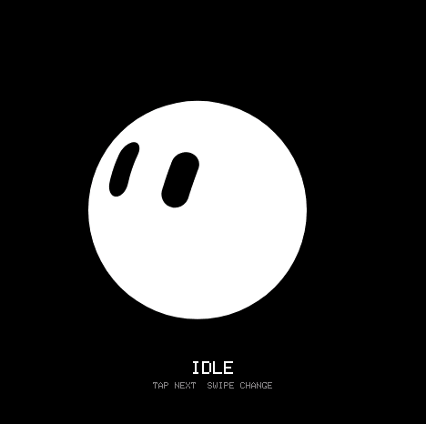
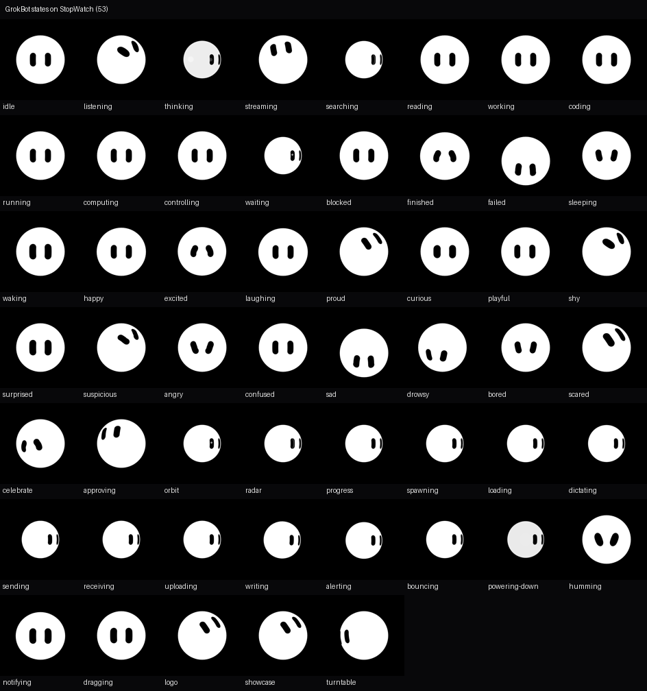

# StopWatch GrokBot

把 [GrokBot 头像解剖](https://grokbot.yin.wiki/index.html) 里的 Grok Bot
动画搬到 M5Stack **StopWatch / C152**（ESP32-S3R8 + 466×466 AMOLED）上运行。



> 图中是 ESP Workbench 的真实固件 framebuffer，不是网页合成图。

IDLE 正放/倒放 GIF（Web Burner 封面可用）：


## 当前效果

- 网页中的 **53 个命名状态已全部加入**：生命周期、反应、morph、产品状态和品牌动画。
- 9 种表情、13 类 morph、28 段 clip 的视觉类型均包含在状态库中。
- 所有状态统一从第 3 帧开始播放。
- 每个状态播放到末帧后按帧反放回循环起点，再正向播放；不再硬跳首帧。
- 单击触摸屏切换到下一个状态；A/B 键控制上一个/下一个状态。
- 400×400、16 级灰度、30 FPS。
- 帧间 XOR + zlib 压缩，完整图集约 **8.39 MiB**。
- 实机直连 CO5300，稳定 **30 FPS**。

全部状态：



## 硬件与验证

- 目标：M5Stack StopWatch（C152），ESP32-S3R8，16 MiB Flash，8 MiB PSRAM。
- 屏幕：CO5300 QSPI AMOLED，468×468 framebuffer，可见 466×466 圆形区域。
- 浏览器验证：ESP Workbench 中固件启动、framebuffer 抓取和状态切换通过。
- 实机验证：显示、灰阶、30 FPS、A/B 状态切换正常。

## 交互

| 输入 | 动作 |
| --- | --- |
| A / GPIO2 | 下一个状态 |
| B / GPIO1 | 上一个状态 |
| 单击触摸屏 | 下一个状态 |

## 构建与烧录

```sh
git submodule update --init --recursive
. "$HOME/esp/v5.5.3/esp-idf/export.sh"
idf.py set-target esp32s3
idf.py build
idf.py -p /dev/ttyACM0 flash monitor
```

Web Burner 需要使用从 `0x0` 烧录的完整镜像，不能直接上传应用分区
`build/stopwatch_grokbot.bin`：

```sh
idf.py merge-bin -o stopwatch_grokbot-full.bin
```

生成后上传 `build/stopwatch_grokbot-full.bin`。该文件已合并 bootloader、
分区表和应用镜像。

`main/idf_component.yml` 会自动获取 M5PM1、M5IOE1、I2C bus 组件；
`components/M5GFX` 固定到 0.2.35。

启动后串口应出现：

```text
I (...) grokbot: Atlas: 400x400, 53 states, 30 fps
I (...) grokbot: GROKBOT_READY states=53 fps=30
I (...) grokbot: fps=30 state=idle frame=... start=2 decode=...us push=...us
```

## 设备端实现

1. 浏览器按 30 FPS 逐帧渲染 53 个状态。
2. 每帧量化为 4-bit 灰度，帧间做 XOR delta，再用 zlib 压缩。
3. ESP32-S3 使用 ROM 自带 miniz 逐帧解压，经 XOR 还原并展开为 RGB565。
4. 使用 `lgfx::swap565()` 直接写入 sprite 的 `rgb565_2Byte` 缓冲区。
5. 禁用 M5GFX 的整屏 PSRAM 中间帧缓冲，400×400 数据直接送入 CO5300。
6. 状态动画采用正放/倒放的 ping-pong 循环；倒放时用当前帧的 XOR 差分反推上一帧，不需要额外存储反向帧。
7. 每个 clip 首帧为完整帧，其余帧使用 XOR delta，保持 30 FPS 和较小的 Flash 占用。
8. 所有状态从索引 2（第 3 帧）开始；切换时从目标状态第 0 帧完整重建到起始帧，避免 XOR 基准残留造成重影。

## 重新生成动画图集

需要 Node.js、Chrome、Python 3、Pillow 和 NumPy：

```sh
cd tools/grokbot
npm install
python3 -m pip install -r requirements.txt
node bake.mjs
```

脚本会生成 53 个状态帧，并写入 `main/grokbot.atlas`。
原始播放器与 recipe 位于 `third_party/grokbot/`。

## 目录

```text
main/board.cpp           PMIC、IO expander、触摸和按键初始化
main/display.cpp         CO5300 / M5GFX 显示初始化
main/grokbot_player.cpp  GBZ1 压缩图集和帧索引解析
main/main.cpp            zlib 解压、帧重建、轻点切换和 ping-pong 主循环
main/grokbot.atlas       53 状态和循环数据的设备内嵌图集
tools/grokbot/           浏览器烘焙和 zlib 编码工具
third_party/grokbot/     原版浏览器播放器与 recipe
```

## 已知边界

- 多 clip 状态使用该状态的代表 clip；没有把同一状态的每个随机 clip 变体都重复烘焙。
- 所有状态从第 3 帧开始，morph 入场的前两帧被跳过。
- Grok Bot 名称和角色设计归其权利人；`third_party/grokbot/` 中的解析/播放器代码
  来自 <https://grokbot.yin.wiki/>。
